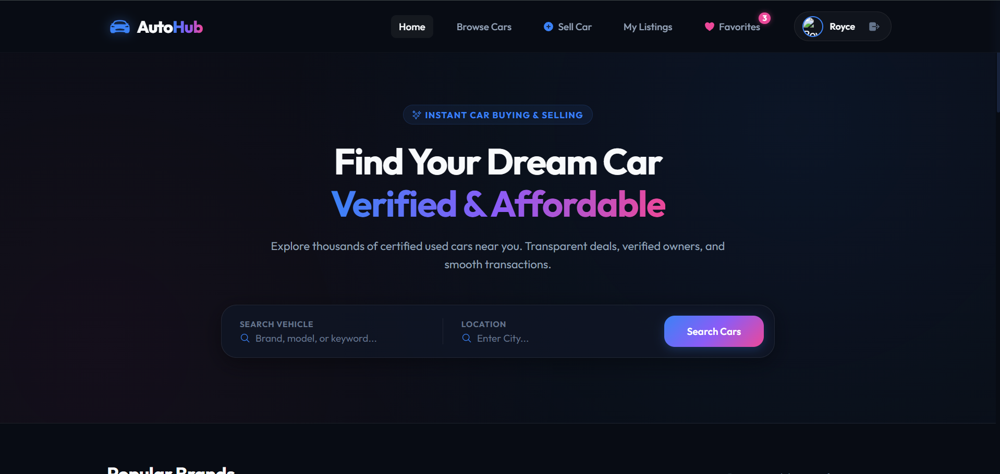
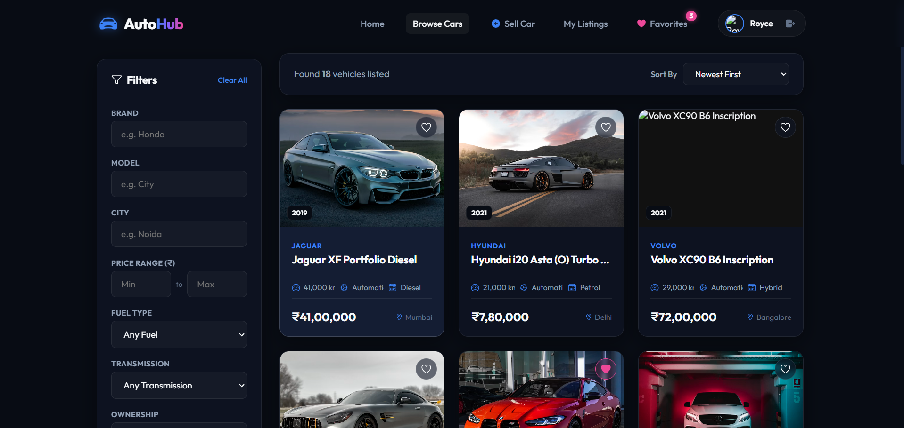
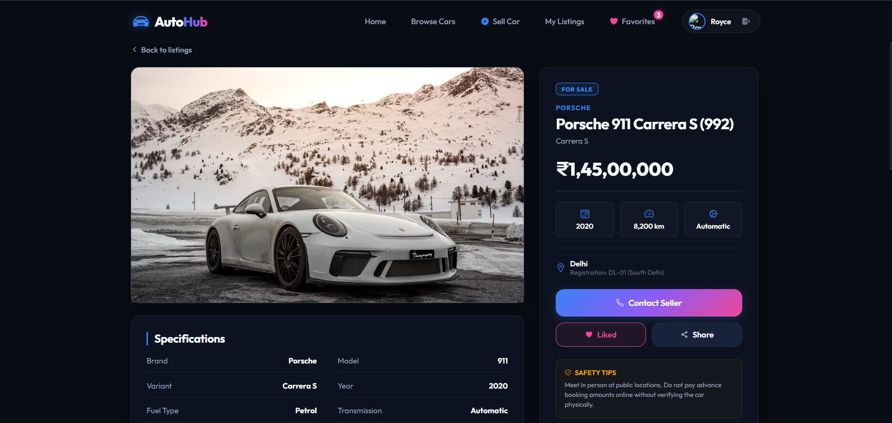
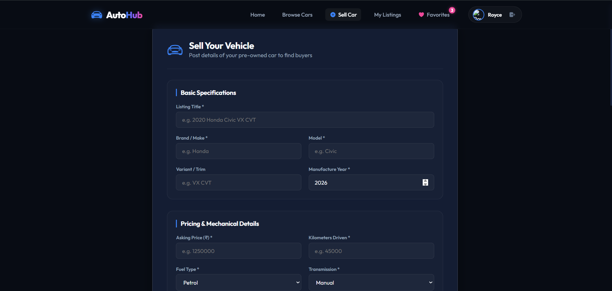
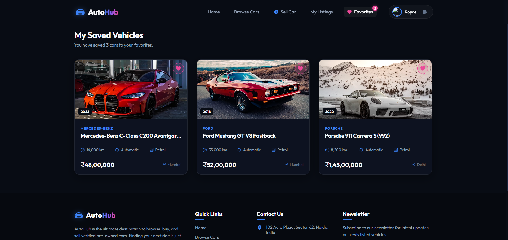
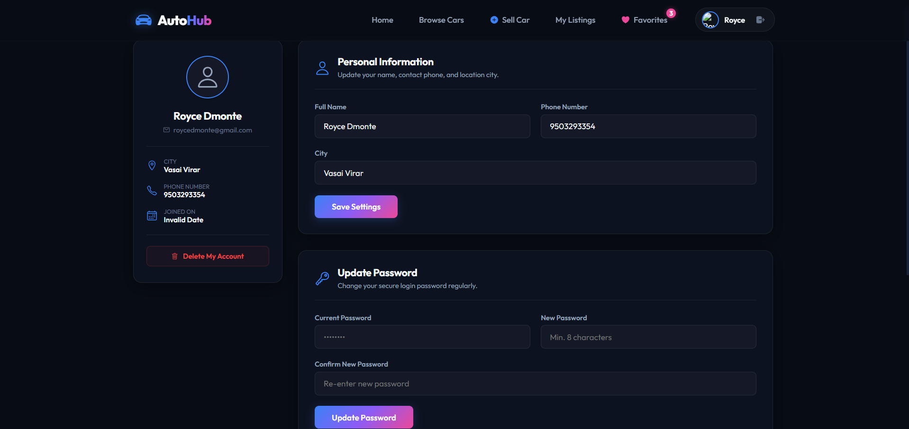
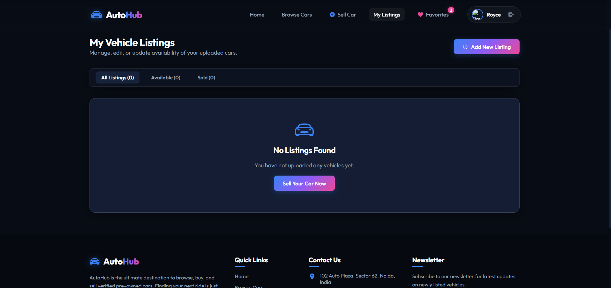

# 🚗 AutoHub - Used Car Marketplace

<p align="center">
  
</p>

<p align="center">


</p>

---

## 🌐 Live Demo

**Frontend**

https://auto-hub-sandy.vercel.app/

**Backend**

https://autohub-api-kt12.onrender.com

---

# 📖 About The Project

# 📖 About the Project

**AutoHub** is a modern, full-stack MERN (MongoDB, Express.js, React, and Node.js) web application designed to simplify the process of buying and selling used cars. Inspired by platforms like **CarWale**, **CarTrade**, and **OLX Autos**, the application provides a secure and user-friendly marketplace where individuals can list their vehicles for sale, explore available listings, compare options, and connect with potential buyers.

The project was developed to demonstrate the implementation of a production-ready full-stack architecture using industry-standard technologies. It emphasizes scalable RESTful API design, secure authentication, responsive user interfaces, efficient database management, and best development practices. Every component of the application—from user authentication to vehicle listing management—has been built with modularity, maintainability, and performance in mind.

AutoHub allows users to create an account, securely log in using **JWT-based authentication**, and manage their personal vehicle listings through a dedicated dashboard. Sellers can upload detailed information about their vehicles, including specifications, pricing, ownership details, images, and descriptions. Buyers can browse listings, perform advanced searches, apply multiple filters, save favorite vehicles, and view comprehensive car information before contacting the seller.

To enhance the user experience, the application includes features such as dynamic search, multi-criteria filtering, pagination, responsive layouts, loading skeletons, toast notifications, and an integrated **Loan EMI Calculator** that helps users estimate monthly installment payments before making a purchase decision.

The backend follows a clean REST API architecture using **Express.js**, while **MongoDB Atlas** serves as the cloud-hosted NoSQL database for storing user accounts, vehicle listings, and favorite collections. Sensitive information such as passwords is securely encrypted using **bcrypt**, and protected routes are implemented using **JSON Web Tokens (JWT)** to ensure that only authenticated users can access restricted resources.

The frontend is developed using **React 19** and **Vite**, providing a fast, responsive, and component-based user interface. State management is handled using the **Context API**, while **Axios** is used for seamless communication with the backend APIs. The application has been designed with a modern glassmorphism-inspired dark theme to deliver a clean and intuitive user experience across desktop, tablet, and mobile devices.

The project is deployed using a modern cloud architecture:
- **Frontend:** Vercel
- **Backend:** Render
- **Database:** MongoDB Atlas

Overall, AutoHub demonstrates proficiency in full-stack web development by integrating authentication, CRUD operations, RESTful APIs, cloud database management, secure authorization, responsive UI design, and deployment into a single production-ready application. It serves as both a practical marketplace solution and a portfolio project showcasing industry-relevant software engineering skills.

# ✨ Features

## Authentication

- User Registration
- Secure Login
- JWT Authentication
- Protected Routes
- Password Hashing using bcryptjs
- Profile Management
- Change Password
- Delete Account

---

## Car Marketplace

- Browse Cars
- View Car Details
- Sell Used Cars
- Edit Listings
- Delete Listings
- Mark Listing as Sold
- Image Uploads
- Seller Information

---

## Search & Filters

- Brand
- Model
- City
- Fuel Type
- Transmission
- Ownership
- Price Range
- Search Keywords
- Pagination

---

## User Features

- Favorites
- My Listings
- Responsive Dashboard
- Profile Management

---

## UI Features

- Modern Glassmorphism Design
- Responsive Layout
- Dark Theme
- Loading Skeletons
- Toast Notifications
- Loan EMI Calculator

---

# 📸 Application Screenshots

## 🏠 Home Page



## 🚘 Browse Cars




## 🚗 Car Details




## ➕ Sell Car



## ❤️ Favorites



## 👤 Profile



## 📋 My Listings




# 🏗️ System Architecture

```
React Frontend
        │
        ▼
Axios REST API
        │
        ▼
Express.js Server
        │
Controllers
        │
Mongoose ODM
        │
MongoDB Atlas
```

---

# 🛠️ Technical Stack

## Frontend

- React 19
- React Router DOM
- Axios
- Context API
- CSS Modules
- CSS Variables
- React Icons
- Vite

---

## Backend

- Node.js
- Express.js
- MongoDB Atlas
- Mongoose
- JWT Authentication
- bcryptjs
- Multer
- Express Validator
- Helmet
- Express Rate Limit

---

## Deployment

Frontend

- Vercel

Backend

- Render

Database

- MongoDB Atlas

---

# 📁 Folder Structure

```text
AutoHub/
├── client/
│   ├── src/
│   │   ├── components/
│   │   ├── context/
│   │   ├── pages/
│   │   ├── services/
│   │   ├── styles/
│   │   └── assets/
│   ├── public/
│   └── package.json
│
├── server/
│   ├── config/
│   ├── controllers/
│   ├── middleware/
│   ├── models/
│   ├── routes/
│   ├── uploads/
│   ├── utils/
│   └── server.js
│
├── screenshots/
│
├── README.md
└── .gitignore
```

---

# ⚙️ Installation

## Clone Repository

```bash
git clone https://github.com/yourusername/autohub.git
```

```bash
cd AutoHub
```

---

## Backend Setup

```bash
cd server
```

```bash
npm install
```

Create a `.env` file inside the `server` folder.

```env
PORT=5000
MONGODB_URI=your_mongodb_connection_string
JWT_SECRET=your_super_secret_jwt_key
JWT_EXPIRES_IN=7d
```

Start backend

```bash
npm run dev
```

---

## Frontend Setup

```bash
cd client
```

```bash
npm install
```

Create a `.env` file:

```env
VITE_API_URL=http://localhost:5000/api
```

Start frontend

```bash
npm run dev
```

Visit

```
http://localhost:5173
```

---

# 📡 REST API

## Authentication

| Method | Endpoint |
|---------|----------|
| POST | /api/auth/register |
| POST | /api/auth/login |
| GET | /api/auth/profile |
| PUT | /api/auth/profile |
| PUT | /api/auth/change-password |
| DELETE | /api/auth/delete-account |

---

## Cars

| Method | Endpoint |
|---------|----------|
| GET | /api/cars |
| GET | /api/cars/:id |
| POST | /api/cars |
| PUT | /api/cars/:id |
| DELETE | /api/cars/:id |
| PATCH | /api/cars/:id/sold |

---

## Favorites

| Method | Endpoint |
|---------|----------|
| GET | /api/favorites |
| POST | /api/favorites/:carId |
| DELETE | /api/favorites/:carId |

---

# 🔒 Security

- JWT Authentication
- Password Hashing
- Protected Routes
- Input Validation
- Helmet
- Rate Limiting
- Environment Variables

---

# 🚀 Deployment

### Frontend

Vercel

### Backend

Render

### Database

MongoDB Atlas

---

# 🔮 Future Improvements

- Cloudinary Image Upload
- Google Authentication
- Compare Cars
- Recently Viewed Cars
- Admin Dashboard
- Vehicle Recommendations
- Real-time Chat
- Payment Integration
- Google Maps Integration

---

# 👨‍💻 Author

**Royce D'Monte**

GitHub

https://github.com/YOUR_USERNAME

LinkedIn

https://linkedin.com/in/YOUR_PROFILE

---

## ⭐ Support

If you found this project useful, consider giving it a ⭐ on GitHub.